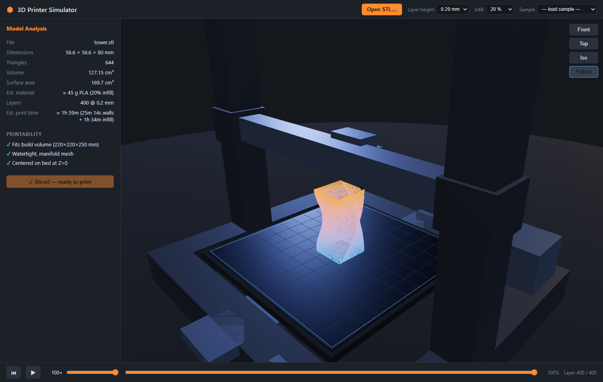

<a href="https://www.buymeacoffee.com/ArabicAI" target="_blank"></a>

**Related video:** [Watch the YouTube video](https://www.youtube.com/watch?v=18jSTSfxMWQ )

# 3D Printer Simulator

A browser-based FDM 3D-printer simulator. Upload an STL file, get a full
analysis (dimensions, volume, material, print-time estimate, printability
checks), then watch a stylized Ender-3-style printer build the part layer by
layer — from any camera angle, at any playback speed.



## Features

- **STL upload** — binary and ASCII, via file picker or drag-and-drop; bundled samples in the header dropdown.
- **Analysis** — dimensions, triangle count, volume (signed tetrahedra), surface area, estimated PLA grams at the chosen infill, layer count, and a print-time estimate (perimeter toolpath + infill approximation).
- **Printability checks** — build-volume fit (220×220×250 mm), watertight/manifold edge-pairing test, and a one-click *Center on bed & drop to Z=0*.
- **Real slicing** — the mesh is sliced into layers in a Web Worker (mid-layer planes, triangle bucketing, segment chaining into closed contours, collinear simplification), then converted to an ordered toolpath with travel moves.
- **Simulation** — bedslinger kinematics (head moves X/Z, bed moves Y); the nozzle traces every contour while printed material appears as extrusion-width 3D strands with a blue→orange layer gradient. Nozzle position is a pure function of sim time, so scrubbing and 100× speed are O(log n).
- **Controls** — play/pause (space), 0.5×–100× speed, progress scrubber, layer indicator, restart, camera presets (Front/Top/Iso) and a nozzle-follow camera.

## Run

```sh
npm install
npm run samples   # generate sample STL files into public/samples/
npm run dev       # open the printed URL
```

## Test

```sh
npm test                                   # vitest unit tests for the core modules
node scripts/e2e-check.mjs <dev-url>       # headless-Chrome end-to-end check + screenshots
```

## Architecture

```
src/core/      pure algorithms (no DOM/three.js) — parser, analysis, slicer, toolpath
src/workers/   slicer web worker (zero-copy transfers of typed arrays)
src/scene/     three.js: renderer, stylized printer model, progressive print rendering, cameras
src/sim/       playback clock (binary search over cumulative-time prefix sums)
src/ui/        plain-DOM panels: file input, report, playback bar, progress overlay
```

Progressive rendering uses a single instanced fat-line batch
(`LineSegments2`); revealing progress is just setting `instanceCount`, so
scrubbing in both directions is instant. Models that would exceed ~2 M
segments automatically fall back to a clipping-plane reveal of the original
mesh plus current-layer tracing (force with `?fallback=1`).
